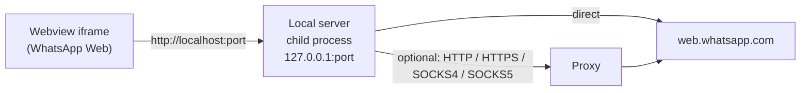

# Architecture

## Components

| Component | File | Runs in | Responsibility |
|---|---|---|---|
| Extension entry | `extension/src/extension.js` | VS Code extension host | Registers the commands and the sidebar view, builds the webview HTML (an iframe to `http://localhost:<port>`), reads settings and the password, forks and stops the server, and points the open webviews at the port the server reports. |
| Local server | `extension/src/server.js` | Child process (`child_process.fork`, `ELECTRON_RUN_AS_NODE=1`) | Reverse proxy built on `http` + `http-proxy-middleware` 2.x. Serves WhatsApp Web, strips framing and security headers, injects the patch, applies the outbound proxy. |
| Patch | `extension/src/patch.js` | Browser (page, workers, service worker) | `rerouteWhatsAppTraffic(scope)`: wraps `WebSocket`, `fetch` and `XMLHttpRequest.prototype.open` so WhatsApp URLs go to the local server. Exported as `PATCH`, the source text `(fn)(self);\n`. |
| Proxy URL builder | `extension/src/proxyUrl.js` | Extension host (and tests) | `buildProxyUrl(settings, password)`: validates settings, returns a proxy URL, `null` (direct) or throws. |
| Tests | `extension/test/proxy.test.js`, `extension/test/server.test.js` | Node (`node --test`) | Unit tests for `proxyUrl.js` and `patch.js`; `server.test.js` forks the real server to test the port fallback. |

Constants in `server.js`: `HOST = '127.0.0.1'`, `PORT_ATTEMPTS = 10`, `PING_PATH = '/__whatsapp-vscode/ping'`, `PING_REPLY = 'whatsapp-vscode'`, `UPSTREAM = ORIGIN = 'https://web.whatsapp.com'`, `USER_AGENT` (a desktop Chrome), `STRIPPED_HEADERS`.

Command and view IDs: `whatsapp-vscode.openWhatsAppWeb`, `whatsapp-vscode.setProxyPassword`, view `whatsappWebview` in container `whatsapp-sidebar`, webview panel type `whatsappWebviewTab`. Secret key: `whatsapp-vscode.proxy.password`. Output channel: `WhatsApp-VSCode`.

## Request flow

Page and asset requests:

1. The webview HTML contains `<iframe src="http://localhost:<port>">`, where `<port>` is the one the server reported.
2. The server forwards a request path as is to `https://web.whatsapp.com`.
3. The response goes through `responseInterceptor`: `x-frame-options`, `content-security-policy`, `content-security-policy-report-only`, `cross-origin-embedder-policy` and `cross-origin-opener-policy` are removed, `Domain=` is stripped from `set-cookie` (localhost rejects it) and `Location` loses the upstream origin. For HTML and JavaScript responses with status 200 the `PATCH` text is injected (inline `<script>` right after `<head>` for HTML, prepended for JavaScript) and `ETag`/`Last-Modified` are removed.
4. Incoming `If-None-Match` and `If-Modified-Since` are deleted, so the server always receives a full body and a copy cached before patching is never revalidated with a 304.
5. Upstream requests and WebSocket upgrades get fixed headers through `headers` (proxy agents connect asynchronously, so `onProxyReq` would run after the headers are sent): `origin`, `referer`, a desktop Chrome `user-agent`, `sec-fetch-site: same-origin` and `accept-encoding: gzip, deflate, br`. Without a browser-like user agent and fetch metadata WhatsApp returns an error page, and `zstd` is left out because `responseInterceptor` cannot decode it.

## How WhatsApp traffic is rerouted

The WhatsApp Web page loads its scripts directly from `static.whatsapp.net` (CORS `*`, works from localhost, not proxied), connects to `wss://web.whatsapp.com/ws/chat` and sends XHR to absolute `https://web.whatsapp.com/ajax/...` URLs (blocked by CORS from localhost). These connections would bypass the local server and the configured proxy, so `patch.js` fixes this:

- `server.js` injects `PATCH` into the HTML (the page scripts are not served by the proxy) and prepends it to every JavaScript response it serves (for example the service worker script), each time with `self` as scope.
- `rerouteWhatsAppTraffic` replaces `scope.WebSocket` with a `Proxy` whose `construct` trap rewrites the URL, `scope.fetch` with a wrapper that rewrites string and `URL` arguments (`Request` objects are passed through unchanged) and `XMLHttpRequest.prototype.open`. `EventSource` is not patched.
- Rewrite rule: `wss|ws://web.whatsapp.com/<rest>` becomes `ws://<scope.location.host>/<rest>` and `https|http://web.whatsapp.com/<rest>` becomes `http://<scope.location.host>/<rest>`. Other URLs are untouched. A guard (`__whatsappVscodeReroute`) prevents double wrapping.
- WebSocket upgrades are handled by `server.on('upgrade', proxy.upgrade)` and use the same agent.

## Process lifecycle

1. `activate()` registers commands, views and listeners, then calls `startServer(secrets)`.
2. `startServer` reads the `whatsapp-vscode` settings (`proxy.*` and `server.port`) and the password from SecretStorage, waits for `stopServer()` to finish (the old server must release the port first, otherwise the new one would find it busy and move to the next port), validates the port (integer, 1024-65535) and builds the proxy URL. On an invalid port or invalid proxy settings it logs, shows an error message and returns without starting a server.
3. It forks `src/server.js` with `ELECTRON_RUN_AS_NODE=1` and `stdio: ['ignore', 'pipe', 'pipe', 'ipc']`, pipes stdout/stderr to the Output channel, and sends `{ proxyUrl, port }` over IPC (`proxyUrl` is `null` for direct).
4. The server creates the agent (`HttpsProxyAgent` for `http:`/`https:`, `SocksProxyAgent` for `socks*:`) and tries `port`, then the next ports, up to `PORT_ATTEMPTS` candidates (never above 65535):
   - If `listen` succeeds, it logs "Listening on ..." and sends `{ ready: <port> }`.
   - If the port fails with `EADDRINUSE` or `EACCES` (the latter covers ports reserved by the OS, for example Windows excluded port ranges), it probes `GET PING_PATH` on that port with a 1 second timeout. The reply `PING_REPLY` means the server of another VS Code window owns the port: it sends `{ ready: <port> }` (the webviews use that server) and retries `listen` on the port every 2 seconds. When the other window releases it, this server takes over with its own proxy settings. If during the retries the port turns out to be held by a foreign program, it picks a port again starting from the base port.
   - Otherwise it logs "Port N is used by another program, trying the next one" and tries the next port.
   - If no candidate is usable, it logs and sends `{ error: 'No usable port between A and B' }`; the extension shows an error asking to change `whatsapp-vscode.server.port`.
5. The extension has no ready promise. It keeps `serverPort` and the set of open webviews. On `{ ready: port }` with a port different from `serverPort`, it sets the HTML of every open webview to an iframe on `http://localhost:<port>`. A webview opened before the first ready message gets its HTML when the message arrives, so WhatsApp Web never loads before a server answers. If the settings are invalid, no server runs and the webviews stay empty. Messages from a replaced (killed) child are ignored.
6. A change to a `whatsapp-vscode.proxy.*` setting, to `whatsapp-vscode.server.port` or to the stored password restarts the server (a counter, `startRequest`, discards overlapping restarts). A restart that keeps the same port does not reload the open webviews; reload them if connections do not recover.
7. The server exits on IPC `disconnect`, and the extension kills it in `stopServer` (called from `deactivate` and from the subscriptions). It never outlives the extension host.

## Port and origin

The webview content is an iframe with origin `http://localhost:<port>`. WhatsApp's login session (IndexedDB, localStorage, service worker) lives in the storage of that origin, so each port has its own login. If the port changed on every start the user would be logged out every time, so the port is a setting (`whatsapp-vscode.server.port`, default 49153) and the fallback is deterministic: the base port, then base+1, up to 10 candidates. When the configured port is free again the extension returns to it, and to its login, on the next start. Only one server can own a port at a time; windows share it (see multi-window behaviour in [configuration.md](configuration.md)).

The iframe uses `localhost` while the server binds `127.0.0.1`; this relies on `localhost` resolving to IPv4 loopback.

The sidebar and the editor tab are different webviews. Whether they share the login depends on Chromium storage partitioning; this was not verified.

## Security notes

- The server listens on `127.0.0.1` only.
- Proxy settings have `application` scope: a workspace's `.vscode/settings.json` cannot change them, so an opened repository cannot redirect WhatsApp traffic.
- The password is stored in SecretStorage (OS keychain), never in settings. It is embedded in the proxy URL only in memory and over the IPC channel; the server log prints host and port only (`describe()`), plus "(with credentials)".
- Fail closed: invalid settings never start the server and never fall back to a direct connection. With an unreachable proxy requests fail (HTTP 500) instead of going direct.
- Proxy host names are resolved by the proxy (`socks5h`, `socks4a`), so local DNS filtering does not apply to WhatsApp host names.
- There is no authentication on the loopback port: any local process can use the server as a relay to `web.whatsapp.com` (through the configured proxy). The server is stateless; the WhatsApp session lives in the webview's storage, not in the server.
- `buildProxyUrl` validates the host with a strict pattern to prevent URL injection through the settings (for example `evil.com/x@a`).

## Design decisions

| Decision | Reason | Rejected alternative |
|---|---|---|
| Run the server in a forked child process on VS Code's runtime | Inside the extension host VS Code patches Node's `http`/`https`. With the default `http.proxySupport: "override"` (VS Code 1.146, `@vscode/proxy-agent` 0.46) an explicit `agent` passed by an extension is dropped for non-localhost hosts, so the proxy agent would be ignored. The child process is not patched. `ELECTRON_RUN_AS_NODE=1` reuses VS Code's own runtime. | Server inside the extension host (agent ignored). Per-platform `pkg` binary (pre-1.3.0; Node 14, binaries outside git, never stopped). |
| Patch `WebSocket`/`fetch`/XHR in injected JavaScript | The chat WebSocket and the XHR requests bypass the local server otherwise. | Proxy only the page requests (messaging would be unproxied). |
| Keep serving the live WhatsApp Web | Always current; no vendoring. | Bundle WhatsApp Web locally: not redistributable, manual updates. |
| Reverse proxy + web client | Small code base. | Unofficial native client library with a custom UI: a full UI rewrite and a risk for the account. |
| Configurable base port (default 49153) with deterministic fallback to the next 9 ports | The origin, and with it the WhatsApp login, stays stable between starts, while a port used by another program does not block the extension. | Random port: the origin would change and the login would be lost every start. |

## Known limitations and root causes

- **No voice messages and no calls.** The webview iframe policy has no `microphone` or `camera` permission.
- **Content-Security-Policy removed.** The CSP headers are removed so the rerouted connections to `http://localhost:<port>` are allowed. If WhatsApp enforces such restrictions some other way, messaging would break.
- **Unpatched channels.** `EventSource` and `fetch(new Request(...))` are not rewritten.
- **Static resources not proxied.** Scripts and media from `static.whatsapp.net` and other hosts load directly from the browser, not through the configured proxy.
- **One server per port.** Only one window's server serves on a port; its proxy settings apply to all windows sharing it.
- **One login per port.** Each port is a separate origin, so a fallback port or a changed `whatsapp-vscode.server.port` needs the device to be linked again.
- **Untested proxy types.** HTTP, HTTPS and SOCKS4 were not tested against a real proxy (unit-tested URL building only). SOCKS5 was verified with `curl` against the server (HTML served, patch injected, headers removed).
